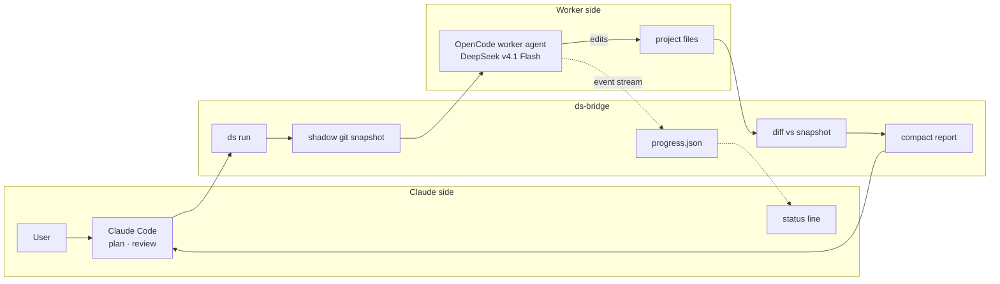
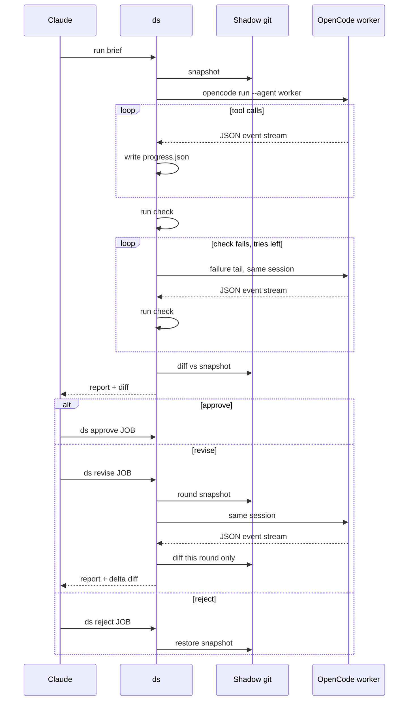
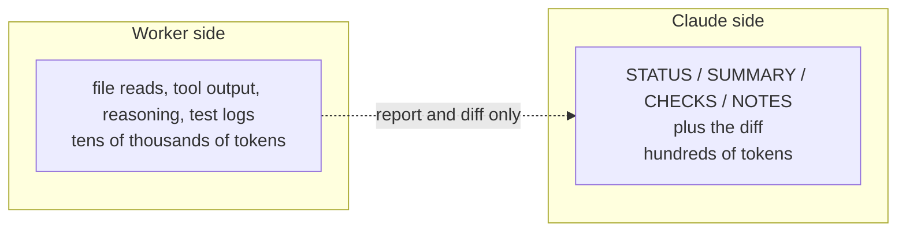

# ds-bridge

Claude plans and reviews, DeepSeek types. A cheap OpenCode worker for Claude Code that returns a summary and a diff, not files.

## Why

Claude usage is expensive, and delegating only saves it if Claude spends fewer turns and tokens than doing the work itself. Every Claude turn re-reads the whole conversation, so ds-bridge is built around one call per job: Claude sends a short task with a check, the call blocks until the worker is done, a passed check lands the change by itself, and Claude reads a result block of a few lines (about 100–150 tokens). The diff is computed by the bridge, not reported by the worker, and Claude only sees it when something needs a look.

This README, the installer and the live-progress feature were written by the worker through ds-bridge itself, then reviewed by Claude.

## How it works





**What Claude reads vs what stays with the worker**



## Live progress

Claude Code's status line can poll ds-bridge once a second (`refreshInterval: 1`) and render the worker's current step:

```
⠴ DeepSeek 1104-152450 r1 · 0:05 · step 2 · 4 tools · 144 tok · ▶ 162 tok/s · ▸ read notes.txt
⠙ DeepSeek 1104-152510 r1 · 0:02 · step 1 · 1 tool · 18 tok · ⏸ 6s · ▸ bash sleep 6
⠹ DeepSeek 1104-152510 r1 · 0:04 · step 1 · 1 tool · 18 tok · … working · ▸ bash sleep 6
✓ DeepSeek 1104-152450 done in 0:11
DeepSeek idle · 4 jobs today
```

Each active job gets its own line, up to four; when nothing is running the line shows today's ledger instead. Every chat sees only its own jobs: ds records the Claude Code session that ran (or last revised) a job, and jobs from other chats collapse into one `+N DeepSeek jobs in other chats` line while they run. Jobs started outside Claude Code show in every chat. A run or revise that lasts at least `notify_min_s` seconds also sends a desktop notification with the job id, project, duration and check result.

There is no percentage. An agent can't know its step count in advance, so the line shows elapsed time, the step reached so far, and the last tool call instead of inventing a progress bar.

While a job runs, ds also reads the OpenCode service's event stream (`~/.local/state/opencode/service.json`). The status line shows the live generation rate (`▶ N tok/s`) while the model writes, `✎ tool Ns` while tool arguments are being generated, an elapsed tool timer (`⏸ Ns`) while a tool runs, and `… working` when no output is streaming (waiting for the first token, or the model writing tool arguments, which OpenCode does not stream). The live rate uses only active generation time in the last five seconds, calibrated against completed steps; long pauses and tool execution do not lower it. If the stream is unavailable, no live rate is shown.

The final report's `tok/s` is measured, not estimated: token counts are the provider's exact per-step numbers. With OpenCode 2.3 or newer the times are the service's own: `session.step.first-token` (the provider's first output event, hidden reasoning included) and `session.step.streamed` (end of the response body). Each step counts output + reasoning tokens over `streamed - first-token`, summed before dividing: the same formula as OpenCode's footer and DeepSeek's harness, so Flash and Muse are measured alike. The time to first token follows as `· ttft X.Xs`. While a job runs, `▶ N tok/s` is the exact speed of the last finished step (nothing is shown before the first step ends). Older OpenCode versions don't send first-token, so ds falls back to SSE arrival times: decode between the first and last generation event when the model streams its output, otherwise throughput marked `incl. wait`, and a live rate estimated from characters marked `~`. The ledger keeps `dec_tok_s`, `thr_tok_s` and `tok_src` (`opencode` or `sse`). Without the event stream ds prints no speed.

## Commands

| Command | Description |
| --- | --- |
| `ds run -C <dir> --check "<cmd>" "<task>"` | Quick task: the worker explores, ds checks; a pass lands by itself. `--files`, `--source`, `--brief <research id>`, `--fix`. A full brief (GOAL/…/DONE WHEN) also works. |
| `ds batch -C <dir> plan.md [--steps "1-2,3"]` | Run a plan's steps as parallel jobs, land them, run the integration check; one block back. |
| `ds reply JOB <a-d or answer>` | Answer a BLOCKED job's question in the same session. |
| `ds wait JOB [--until-done]` | Result of a job that was still `RUNNING` when `ds run` returned. `--until-done` waits without the 540 s limit (ceiling `until_done_max_s`); run it as a background Bash call so Claude gets one notice instead of polling. |
| `ds init [-C <dir>] [--refresh]` | Start a job that writes or refreshes `AGENTS.md` at the project root. |
| `ds revise JOB "<points>"` | Send numbered feedback in the same session; shows only this round's diff. |
| `ds diff JOB [PATH…]` | Re-show the diff, optionally `--full` or for specific paths. |
| `ds approve JOB [JOB …]` | Accept jobs that did not land by themselves (no check, changes outside `--paths`), or finalize landed ones. Several jobs in one call. |
| `ds reject JOB [--force]` | Undo only the job's own file changes; files changed since the job are skipped unless `--force`. |
| `ds list` | List recent jobs with status and round. |
| `ds status [JOB\|BATCH]` | One line per running job (model, elapsed, step, tools, tokens, last action), or every job of one batch. |
| `ds stats [--days N \| --all]` | Summarise the ledger: jobs, rounds, worker time, worker tokens (provider-reported), ds output read by Claude, median speeds. |
| `ds cost [SESSION_ID]` | What a Claude Code chat cost, measured from its transcript: model calls, context growth, weighted tokens, and what the re-read context consisted of. |
| `ds cost [SESSION_ID] --detail` | Also the single most expensive items (each tool result or piece of Claude's own output, by what re-reading it cost until compaction or the end) and cache rebuilds (calls that had to write an expired context again). |
| `ds handoff -C DIR - <<'EOF'` | Save notes for a fresh chat (goal, decisions, done, next, key files) to `DIR/.plan/HANDOFF.md`, with this chat's open jobs and delegation state. After `/clear`, the next chat of the same project starts with them. |
| `ds log JOB [--tools-only]` | Print a readable transcript of the job's OpenCode session. |
| `ds delegate on\|off\|status [--session ID]` | Per-chat delegation mode (session defaults to `CLAUDE_CODE_SESSION_ID`); `on` prints the planner playbook. |
| `ds research [-C DIR] [--paths P…] [--words N] "question"` | Read-only answer with refs, no diff. |
| `ds rebase JOB` | Fresh private copy + the job's changes, conflicts left as markers. |
| `ds playbook` | Print the planner playbook: Claude's rules for briefs and reviews, with the brief template. |

Flags: `-C DIR` sets the project directory (`run` and `init`), `-m MODEL` overrides the model for one job, `-f FILE` attaches a file to the brief (repeatable, also on `revise`; images become reference pictures the worker can see), `--paths P…` limits the job's file scope, `--timeout S` overrides `job_budget_s` for this invocation (`run`, `init`, `revise`), and `--check CMD` / `--fix-tries N` control the acceptance check (also on `revise`), and `--fix` turns on the reproduction-test rule.

### The default flow

```
ds run -C <dir> --check "node --test test/pricing.test.js" --files "src/pricing.js, test/pricing.test.js" - <<'EOF'
Bug: total() ignores discount. A fractional discount must reduce the subtotal before tax, rounded to the cent. Fix it and add a regression test.
EOF
```

- **Quick task.** A few plain lines plus `--check`; the worker finds the exact places itself. `--source` passes the user's words verbatim so the worker can flag where the task and the request disagree; `--brief <id>` hands it a `ds research` answer instead of Claude copying it. A brief with all six sections (GOAL, CONTEXT, FILES, STEPS, DO NOT, DONE WHEN) still works and is linted as before; it is meant for work a check cannot judge, such as visual or creative work.
- **One blocking call.** `ds run` waits up to `wait_s` (540 s, under the Bash tool's 10-minute limit). A longer job keeps running detached and `ds run` prints `RUNNING <job>; next: ds wait <job> --until-done`, which Claude runs once in the background: one notice when the job ends instead of a Claude turn every nine minutes. In delegated chats the discipline hook refuses a foreground `ds wait`.
- **Auto-land.** A job whose check passed (no worker errors, no changes outside `--paths`, no failed reproduction) lands at once: a private copy is 3-way applied to the project, an in-place job simply stays. If the project changed under it, ds rebuilds the copy, re-applies the change with conflict markers and asks the same worker session to resolve them (one automatic redo) before giving up with `CONFLICT`. `ds reject JOB` undoes a landed job for a day; after that it is finalized. Set `auto_land` to `false` to approve by hand.
- **The result block.** The first word decides: `OK`, `FAIL`, `BLOCKED`, `CONFLICT`, `PARTIAL`, `PROVIDER` or `ERROR`. Then `summary:`, `changed:` (files with +/-), and only the lines that carry information: `risks:`, `review:` (at most 5 `path:start-end` ranges), `missing:`, `disagree:`, `visual:`, `question:` (with a-d options), `found:`, `error:` (the condensed check failure), notes. The block is capped at `max_block_chars` (1,600). The diff follows only when nothing vouches for the change (no check, or a failure), and a `next:` line names the one action left.
- **A check that cannot run** (exit 126/127, `command not found`, missing pytest) is reported as `check=env` and skips the fix rounds: no code edit fixes a missing tool.

### Batches

`ds batch -C <dir> plan.md` runs a plan file's steps as parallel jobs, each in its own private copy, and prints one block:

```
# Shopkeep: removeItem, discount fix, CLI docs
Node ESM project; keep the code style.
check: `node --test`

## 1 removeItem
files: src/inventory.js, test/inventory.test.js
do: Add removeItem(inv, sku) ... and tests.
done-when: `node --test test/inventory.test.js`

## 2 CLI docs
files: README.md
do: Document the CLI under ## CLI ...
done-when: `grep -q "## CLI" README.md`
needs: 1
```

Every step needs `files:` (the job's `--paths`). Groups (`--steps "1-2,3"`, default one per step) run up to `--parallel` at a time; overlapping files run one after another and `needs:` waits for that step to land (a dependency that failed, or passed without landing, skips the step: it would otherwise run against a project that lacks what it builds on). Step ids are numbers or words. `--brief <research id>` gives every step the same research answer; `--timeout <seconds>` sets each job's budget; up to `max_parallel` (6) groups run at once. Each group's backticked `done-when` commands become its check, and passing groups land as they finish. A group that passed but could not land (for example it changed files outside its `files:`) is listed as `passed but NOT landed` with the reason, and the block ends with one `ds approve JOB JOB …` line for all of them; changes to git-ignored files (a check's generated output) never block landing. When all have landed, the plan's `check:` (or `--check`) runs on the combined project; if it fails, one fix job gets the failure and the same check. The block shows one headline per group and the full block only for groups that need action.

### The discipline hook

`hooks/discipline.py` (installed by `install.sh`, active only in chats with delegation on) enforces the rules that save the most Claude usage, after cheap-agent's hook: after a passed result, running tests again is denied until the next user prompt; after a result that did not finish, only reads, ds commands and one question to the user pass (with `"takeover": "sonnet"`: the Agent tool instead), then the state clears (a `FAIL … check=env`, where the check could not run at all, doesn't count). Bash commands that write project files (redirects, heredocs into files, `tee`, `sed -i`, scripts that open files for writing) are denied too; `cp`/`mv` stay allowed, since copying puts no file content through Claude, since they get past the Edit/Write guard; `/tmp`, `~/.claude`, ds state and `.plan/` stay free, and the brief inside a `ds run - <<EOF` heredoc is ignored. ds also records each finished job's or batch's outcome for the chat that started it, and the hook adopts it on Claude's next tool call, so the same rules hold when the result arrives as a background notice (`ds wait --until-done`) that no hook sees.

### Where the rules live

`~/.claude/CLAUDE.md` holds only a short pointer (delegation is opt-in, `/ds:on` turns it on). The full rules are `planner-playbook.md`: `ds delegate on` prints them, the delegation hook brings them back after a compaction, and a one-line reminder repeats each turn. A chat that never delegates pays for none of it.

### Context cost: handoffs and the read gate

Every Claude call re-sends the whole chat, so a chat's cost grows with the square of its length. In a measured 3 h video chat (05-probe, 125 calls, context 46k -> 387k), re-reading context was 2.5M of the 3.5M weighted tokens. Splitting that chat into 3–4 sessions would have cut 20–35% of the total (simulated with a 5k–40k token reload per new session). There were no cache rebuilds (the cache outlived a 46 min pause).

- `ds handoff` + `/clear`: at a breakpoint Claude writes short notes, and the user types `/clear`. The `SessionStart` hook (matcher `clear`) gives the notes to the new chat of the same project within `handoff_ttl_s` (2 h). It also carries delegation (and its model) over and moves the open jobs to the new chat. After a fresh `claude` instead, say "continue from .plan/HANDOFF.md".
- Nudge: in a delegated chat, once the context passes `handoff_nudge_tokens` (150k), the per-turn hook asks Claude for a handoff at the next breakpoint. It asks again every `handoff_nudge_step` (75k) more, and starts over after a compaction.
- Read gate: in a delegated chat, a whole-file `Read` or plain `cat` of more than `read_gate_lines` (400) lines is denied once. The denial points to grep, a ranged read or `ds research`, and the same call sent again passes. Skills, memory, `/tmp` and `.plan/` are exempt. Set the option to 0 to turn the gate off.

### `ds research`: learn the code without reading it

`ds research -C <dir> "<question>"` runs a read-only researcher (OpenCode agent `researcher`: edits denied, state-changing git and `rm`/`mv` denied) that answers one question in at most `research_words` words (default 200, `--words N`, max 600), with up to 6 refs as `path:start-end` plus the verbatim anchor line, the commands it ran to verify, a confidence and what it could not determine. `--paths` limits where it looks, `-f` attaches files or images. The output has no diff. Snapshots are taken around the run as for a job; if the researcher changed anything anyway, ds restores it and prints a warning. Planning from this answer instead of opening files keeps source code out of Claude's context (cheap-ag measured Claude reading about two files before each delegation).

### Trusted checks

When the job's `--check` passes, the report shows only the diff stat and `ds diff JOB` for the full diff (config `diff_on_pass`, `"stat"` by default, `"full"` for the old behaviour). The full diff is still shown without a check, on a failed check, on worker errors, a soft deadline or changes outside `--paths`. cheap-ag's measurements: reading every passing diff cost +28% tokens and caught no wrong fix.

### Private copies for parallel jobs

A job with `--paths` (config `isolate`: `"paths"` by default, `"always"`, `"never"`) runs in a copy-on-write copy of the project under `~/.local/share/ds-bridge/work/<job>` (`cp -a --reflink=always`: on btrfs/XFS a 785 MB project copies in 0.3 s and uses no extra space until files change). The worker, its `--check` and any renders run there, so a job never sees another job's half-written files. Absolute project paths in the brief, the check and `-f` files are pointed at the copy, and the worker is told to stay inside it. `ds research` always runs in a copy.

- `ds approve` lands the job: its diff is 3-way applied to the project under a lock (`git apply --3way` through a throwaway index, so the project's own git index is untouched). Files the snapshots skip that the job created or changed in its copy (renders, media, big files) are reflinked back too, unless the project's version changed meanwhile. Only files a snapshot leaves out on purpose travel this way: git-ignored output, excluded media types and big files. A plain file the worker created or changed outside the job's `--paths` is never copied (that would be an unreviewed, unmerged change `ds reject` cannot undo): approve lists it as `NOT landed, outside the job's --paths`.
- If the changes no longer apply (someone edited the same lines), approve prints `CONFLICT` and changes nothing. `ds rebase JOB` makes a fresh copy of the current project and 3-way applies the job onto it, leaving conflict markers; `ds revise` resolves them. Approve refuses while conflict markers remain.
- `ds reject` just deletes the copy; the project was never touched.
- Without reflink support (tmpfs, ext4) the job runs in place as before and the report says why.

Merge logic adapted from cheap-agent's `src/workspace.ts` (MIT).

### Failed checks: short output, early stop, findings

- The report shows a condensed failure instead of raw output: up to 3 distinct failures (repeats counted ×N), each with its message, expected/got lines and the first frame in the project, at most 25 lines (ported from cheap-agent's `errorTail`). The worker still gets the last 60 raw lines.
- If a fix round ends with the same failure as the round before (numbers ignored), the loop stops instead of spending the remaining rounds; the check line says `stopped: the same failure repeated`.
- When the check still fails, the worker is asked for a `FOUND:` note (at most 600 characters: where the problem is, its best hypothesis, what it ruled out), shown under `--- found`. BLOCKED and unfinished reports start their NOTES with the same.
- A report that is not finished (check FAIL, BLOCKED, errors, repro FAILED) ends with a line telling Claude to ask the user: a Sonnet subagent finishes it from the `found:` note, `ds revise`, or stop. Claude doesn't take it over with Opus.

### `--fix`: proven bug fixes

`ds run --fix` adds a rule to the brief: make the fix as soon as it is known, then write a test covering every case the task names, never revert the fix to check it, and report `REPRO: <command running only that test>`. ds then runs that command on the new code (must pass) and on a copy where every non-test change is reverted (must fail), and prints `--- repro: fail→pass verified`, `WEAK` (the test passes on the old code too), `FAILED` or `unverified: <why>`. Only `FAILED` fails the job: a weak or unverified test still lands a fix whose check passed, with a `repro:` line to read. (cheap-agent ticket 52: "test first, see it fail" made workers revert correct fixes or burn turns hunting a failing test.)

### Benchmark

`bench/` measures Claude tokens with and without ds on cheap-agent's fixture and tasks (hidden tests grade the result). See `bench/README.md`.

### Vision: the worker looks at its own output

DeepSeek v4.1 Flash accepts images, so the worker checks visible results itself instead of sending every render back to Claude. When a task produces something visible (UI, web page, plot, image, video frame, slide, PDF), the worker prompt tells it to take a screenshot or extract a frame (`chromium --headless --screenshot`, `ffmpeg`, `magick`), open the PNG with its read tool, crop and enlarge before judging fine detail, fix problems its own change caused, and look again. The report gets a `VISUAL:` line naming each image checked and any problem with its location; doubtful ones are marked `UNSURE` and left unchanged. Scratch images go to `/tmp/ds-*`.

This matters for cost: an image costs Claude about 1.5–1.8k tokens and stays in its context for the rest of the chat, while the `VISUAL:` line costs a few dozen. The images live in DeepSeek's context instead. The playbook tells Claude to add a LOOK step to briefs with visible output (the command, the image path, what must be visible where) and to open an image itself only to confirm a flagged problem or for a final sign-off. Visual reports are a first pass: in tests the worker found real defects but also invented fine detail on small images, which is why it is told to zoom first and to report only problems it can locate.

### `--check` and the fix loop

`ds run -C <dir> --check "pytest -q" "<task>"` runs CMD with `bash -c` in the project after the worker's first answer. If it exits non-zero (or hits `check_timeout_s`), the bridge sends the last 60 lines of output back into the same session and asks for a fix, then runs the check again, at most `fix_tries` times. The report gets a `--- check` section with PASS/FAIL and the number of auto-fix rounds, and the diff includes every change from those rounds.

### Soft deadline

A worker call that passes `soft_timeout_frac × timeout_s` (default `0.8`, so 24 minutes of a 30-minute run) is stopped and the same session is asked for its final report, including anything unfinished. That wrap-up call has its own limit, `wrapup_s` (default `180`). The `--check` still runs afterwards, and the report starts with `SOFT DEADLINE HIT`. This applies to `ds run`, `ds init` and `ds revise`, including auto-fix rounds. Both the hard timeout and the soft deadline interrupt the session through the OpenCode service, not just the `opencode run` client, so the worker stops running tools; the wrap-up call then reaches an idle session. ds chooses the session id itself before the worker starts, so interrupt works from the first second. A job that hit the soft deadline is still `OK` when the worker's wrap-up report says `STATUS: DONE` with nothing under `MISSING` and the check passes; otherwise it is `PARTIAL`. Long steps: `--timeout <seconds>` on `run` and `batch`.

### Git: every project is a repo, every job a worktree

ds works the way cheap-agent does: every job runs in its own **git worktree** under `~/.local/share/ds-bridge/work/<job>`, and only a job whose check passes lands in your project, as **uncommitted** changes (ds never commits; you do). Differences from cheap-agent:

- **No repo? ds runs `git init`** in the `-C` folder (not the chat's folder) and writes a `.gitignore` for media, renders, audio, model weights, `.venv` and caches if there is none. The block says `git: initialized …`. It refuses `~`, `~/Work`, `~/Projects`, `~/Projects/videos` (and `no_init` in the config), a folder that holds other git repos, and a folder with more than `init_max_files` (20000) files or `init_max_mb` (200) MB that git would track, which then gets no `.git`.
- **No commit needed.** The worktree starts from your files as they are now (committed or not, untracked files git doesn't ignore included): ds writes them as a commit object no branch points to, so your branch, index, stash and history stay untouched and a fresh repo stays without commits until you make one.
- **Ignored folders are linked, not missing.** Every folder git ignores (`media/`, `media_narrated/`, `.venv/`, `node_modules/`…) is a symlink into the worktree, so the worker sees your renders, audio and environment; build output and caches (`dist`, `build`, `__pycache__`…) are not linked. As in cheap-agent's ADR-0003, what a job writes into a linked folder (a new render) lands in the project directly; code still lands only on a pass. Ignored loose files are reflinked.
- Several jobs in one project run in parallel; overlapping changes are reconciled when they land (one automatic redo with conflict markers, else `CONFLICT`). `ds reject` undoes a landed job. `"isolate": "never"` runs jobs in place instead (the old overlap guard then applies).

### Usage limits

When the worker's model hits a plan limit (OpenCode Go's 5-hour, weekly or monthly window, a workspace budget or a model's spend limit), OpenCode reports it as an error and ds ends the job with `LIMIT`: a `limit:` line names the limit and when it resets (from the provider's retry-after, when it sends one), a critical desktop notification goes out, and the `next:` line tells Claude to tell you and not retry. With `fallback_model` set, ds first tries that model; the block says if it was limited too.

### Secrets

The worker, `worker-lean` and researcher agents may not read `.env`, `.env.*` (except `.env.example` / `.env.sample`) with the read tool, edit them, or name them in shell commands. A recursive grep in the shell still prints their lines: OpenCode 2.x has no plugin hook on tool output to filter that (cheap-agent's grep filter targets OpenCode 1.x), so that gap is left as is.

### Provider overload

OpenCode already retries a model request for about two minutes when the provider answers "overloaded" or rate-limited. If it still gives up, ds waits (`overload_wait_s`, default 30 s then 90 s, at most `overload_retries` times) and continues in a fork of the session (`opencode run --fork`: new id, same history), asking the worker to pick up where it left off. OpenCode Go pins a session id to one backend cell, so retrying the same id keeps hitting the same overloaded one (found by cheap-agent). The status line shows `provider overloaded · retry N/M` while waiting, the report gets a `NOTE: provider overloaded` line, and a retry is skipped when the job's time budget can't fit it.

### Model failover

If the worker's model still fails on the provider side after the overload retries (overload, rate limit, quota, billing, 5xx), ds continues the same session once on `fallback_model` (off by default; set a model id to enable). Note: OpenCode Go's `muse-spark-*-contributor` models train on request data and only run after you allow that in the OpenCode console privacy settings. The rest of that invocation (fix rounds, the findings note) stays on the fallback; the next `ds revise` starts on the main model again. The report shows a `FAILOVER:` line. A job whose work failed is not failed over: that goes to the ask-the-user step. 

### Job time budget

`job_budget_s` (default `1800`) caps a whole `ds run`, `ds init` or `ds revise` invocation, including check runs and auto-fix rounds; `--timeout S` overrides it for one invocation. Each worker call gets `min(timeout_s, remaining)` and each check gets `min(check_timeout_s, remaining)`; the soft-deadline fraction applies to that per-call limit. If fewer than 60 seconds remain before a fix round, the round is skipped and the `--- check` section says `budget exhausted, N fix rounds skipped`. The budget is mentioned only when it is hit.

### Cleanup on approve and reject

`ds approve` and `ds reject` drop the job's refs under `refs/ds/<job>/` from the shadow repository and remove its temporary index, so old snapshots do not accumulate. At most once per 24 hours per shadow repo they also start a detached `git gc --prune=1.hour.ago` (never `--prune=now`, which could race a concurrent job). Both commands return immediately. Afterwards `ds diff`, `ds approve` and `ds reject` on that job exit with a one-line "job is approved/rejected" message instead of a git error.

### `ds reject` and `--force`

`ds reject JOB` restores only the files that the job itself changed. It compares the current working tree with the job's end-of-round snapshot: unchanged-since-then files go back to the pre-job state, while files edited afterwards (or by a later approved job) are left alone and listed as skipped. `ds reject JOB --force` restores those too. Directories left empty by removing files the job added are deleted, stopping at the project root. Jobs created before end-of-round snapshots existed still restore the whole scope, after a warning.

### `--paths` and parallel jobs

`--paths P…` limits the snapshot, diff and reject scope to those paths relative to `-C`. Independent subtasks can run in parallel: start several `ds run ... --paths <their files>` calls in the background, then review each report as it arrives. Jobs whose paths overlap a running job in the same project are refused. `ds revise` keeps the job's original scope.

With `--paths`, the bridge also records a cheap path/size/mtime listing of the whole project before the run and compares it afterwards. Files outside the job's paths that were created, changed or deleted appear in a `--- WARNING: changes outside --paths` section (up to 20 lines). Paths matching `outside_ignore` are skipped. Nothing is recorded or printed when `--paths` is not used.

Snapshots skip media, build output, big files and dependency/cache directories, so those changes are not in the diff and `ds reject` cannot restore them. To make that visible, each run and revise also compares a cheap listing of excluded files (the job's `--paths` when set, otherwise the whole project; `node_modules`, `.venv`, `venv`, `__pycache__`, `.git` and `.cache` are never entered). When something changed, one compact line is printed, for example `--- NOTE not in diff, not undoable by reject: build/ 12 changed 2 created · media/ 3 created · model.bin 1 changed`. At most five top-level groups are shown plus `+N more groups`. Set `excluded_note` to `false` to disable it.

### `ds init` and AGENTS.md

`ds init -C <project>` is a normal job (snapshot, worker, report, approve/revise/reject) with a built-in task: explore the project and write `AGENTS.md` at the root, at most 40 lines of facts about layout, build/test/lint/run commands, conventions and things not to touch. It is scoped with `--paths AGENTS.md`. If `AGENTS.md` already exists it refuses unless you pass `--refresh`, which asks the worker to update the existing file and keep correct lines. OpenCode loads `AGENTS.md` automatically, so later briefs can be shorter.

### Planner playbook and brief lint

The worker is fast but literal, and it sees no skills, memories or earlier chats: any gap in a brief becomes a guess in the diff. `planner-playbook.md` holds the rules Claude follows as the planner: read the code first and name exact places, decide everything before writing, keep jobs to about 3 files, copy project rules into the brief word for word, write one exact action per numbered step, give DONE WHEN as a command, review step by step and revise with numbered, exact points.

Claude sees the rules in every delegating chat, not only in a memory file, while keeping Claude's reading small (the point of the bridge): `ds delegate on` prints the playbook once (about 360 tokens), the delegation hook adds a one-line reminder each turn (about 60 tokens) and re-injects the playbook only after a context compaction, which could otherwise summarise it away. Two independent paths make that reliable: a `SessionStart` hook with matcher `compact`, and a backup in the per-turn hook, which scans only the new part of the chat transcript for `compact_boundary` records and re-injects the playbook for any compaction the first path did not cover. Both record which compactions they handled, so the playbook is injected once per compaction. If the playbook file cannot be read, or the hook fails while delegation is on, a visible warning is injected instead of nothing. `ds playbook` prints it on demand.

`ds run` also enforces the floor. A brief must have the sections `GOAL:`, `FILES:`, `STEPS:` (numbered), `DO NOT:` and `DONE WHEN:` (`CONTEXT:` is recommended), be at least `brief_min_chars` long (default 300), and avoid vague phrases such as "etc.", "as needed", "appropriate", "something like" or "clean up" outside backticks and the `DO NOT:` section. A `ds revise` needs numbered points. A failing brief is refused before anything runs, with the list of problems and the template. Set `"brief_lint": false` in the config to turn the check off.

### Delegation mode (opt-in per chat)

By default Claude works directly; delegation is switched on per chat. In Claude Code, the `ds` plugin (in `plugin/`, installed by the installer from this repo's local marketplace) adds:

| Command | What it does |
|---|---|
| `/ds:on` | Turn delegation on for this chat (worker: the chat's model, else the default Flash). Also "delegate to deepseek", "use ds". |
| `/ds:muse` | On, with Muse Spark as this chat's worker (hides its reasoning; in a measured video build it ran at about 70 tok/s, slower than Flash). |
| `/ds:flash` | On, with DeepSeek Flash as this chat's worker. |
| `/ds:off` | Off: Claude works directly again. Also "stop delegating". |
| `/ds:status` | Show the state: worker, fallback, extra round, what happens on failure. |

Each prints a status block, e.g.

```
ds delegation: ON in this chat
  worker      muse
  fallback    flash   (provider fails or hits a limit)
  extra round flash   (after the fix rounds fail)
  on failure  Claude asks you first
  switch: /ds:flash or /ds:muse · off: /ds:off
```

The same from a shell: `ds delegate on [--model muse]`, `ds delegate model flash`, `ds delegate off`, `ds delegate status`. The chat's model applies to every `ds run`, `ds research` and `ds batch` in that chat that passes no `-m`. Only `/ds:on` and `/ds:off` are visible to Claude for natural-language use (about 200 tokens per session for the whole plugin); the other three are yours to type. The plugin is a cached copy: after editing `plugin/`, bump its version in `plugin/.claude-plugin/plugin.json` and run `claude plugin marketplace update ds-bridge && claude plugin update ds@ds-bridge`. While it's on, a `UserPromptSubmit` hook (`hooks/delegate.py`) reminds Claude in one line every turn to send all execution through `ds run ...` started in the background, and the guard blocks direct edits even with `guard_allow`, `guard_mode: "warn"` or `guard-off`; only `~/.claude` and `/tmp/claude-*` stay writable. The marker lives in `~/.local/state/ds-bridge/delegate/<session_id>` (from `CLAUDE_CODE_SESSION_ID`), and stale markers are removed after 30 days.

### Guard hook

`install.sh` adds a Claude Code `PreToolUse` hook (`hooks/guard.py`) for `Edit`, `Write`, `MultiEdit` and `NotebookEdit`. Direct edits to project files are blocked with a message to delegate through `ds`; `~/.claude/`, `/tmp/claude-*` scratchpads and globs in `guard_allow` are allowed. Set `guard_mode` to `"warn"` to warn instead of blocking: the edit is not blocked by the hook, you see a warning, and Claude gets a reminder about the delegation rule. Pause it with `touch ~/.config/ds-bridge/guard-off` or `DS_GUARD_OFF=1`. It can't stop edits made through Bash (heredocs, sed), so it is a guardrail, not a sandbox.

Small edits pass even in delegation mode: at most `guard_lines` changed lines per edit (default 20) and `guard_edits_per_file` edits per file per turn (default 2). Delegating a one-liner costs Claude more (a brief plus a review) than making it. The counts live in `~/.local/state/ds-bridge/edits/<session>.json` and the delegation hook clears them on every new user prompt. Set either value to 0 to block all direct edits again.

### Stats and log

Every report appends one line to `~/.local/share/ds-bridge/ledger.jsonl`. `ds stats` prints jobs (distinct ids), rounds (ledger rows), worker time, worker tokens in/cache/out as the provider reported them, how many characters of ds output Claude read, and the median speeds. It no longer prints a "saved" figure: that was the worker's own token count, not a measurement of anything Claude spent.

What a chat really cost Claude is measured by `ds cost [SESSION_ID]` from the Claude Code transcript (API usage of every model call): weighted tokens (cache read 0.1×, cache write 1.25×, output 5×) and the share of the re-read context that came from Claude's own output, shell output, ds output, images and the starting prompt. For a chat that ran ds jobs it also prints a delegation account: what delegating cost Claude (the calls that ran ds, plus re-reading briefs and ds output later), the lines the worker landed, and the least Claude would have paid to type those lines itself (no reading, no test runs, no mistakes, one call per file, 2.2 characters per token). The verdict is either "saved at least X" or "a saving is not shown"; the real saving beyond that floor cannot be measured from one chat. Known limits: a revised job counts only its last round's lines, and subagent cost is not included.

`ds log JOB` exports the session; `--tools-only` hides text and shows the tool calls.

## Install

Requirements:

- Claude Code with status-line `refreshInterval` support.
- OpenCode 2.x with a DeepSeek-capable provider — for example an OpenCode Go subscription, model `opencode-go/deepseek-v4.1-flash`.
- `python3`, `git` and `jq` (used by the status line).

```bash
git clone https://github.com/vladgabrielboca/ds-bridge.git
cd ds-bridge
./install.sh
```

The installer merges the `worker` agent into `~/.config/opencode/opencode.json` (backing it up first), links `ds` into `~/.local/bin`, adds the status line, the `PreToolUse` guard hook and the `UserPromptSubmit` delegation hook to `~/.claude/settings.json`, and installs the Claude Code plugin `ds` (`/ds:on`, `/ds:muse`, `/ds:flash`, `/ds:off`, `/ds:status`) from this repo's local marketplace. It never edits `CLAUDE.md` itself, so finish by adding the rules in `claude-rules.md` to `~/.claude/CLAUDE.md` (or a project `CLAUDE.md`). It creates `~/.config/ds-bridge/guard-off`, so the guard only acts in chats with delegation mode on; delete that file to guard every chat.

`./install.sh --uninstall` removes the worker agent, the symlink, the status line and the guard hook, touching only what ds-bridge created.

> OpenCode Go DeepSeek models need the workspace region set to **Global** in its Privacy settings.

## Configuration

Optional `~/.config/ds-bridge/config.json` overrides these defaults:

| Key | Default | Meaning |
| --- | --- | --- |
| `model` | `opencode-go/deepseek-v4.1-flash` | Model used by the worker. |
| `agent` | `worker` | OpenCode agent to run. |
| `max_diff_lines` | `250` | Lines of diff shown to Claude before truncation. |
| `max_report_chars` | `1500` | Cap on the worker's report (about 180 words). |
| `timeout_s` | `1800` | Per-run timeout. |
| `soft_timeout_frac` | `0.8` | Fraction of `timeout_s` after which the worker is stopped and asked to wrap up. |
| `wrapup_s` | `180` | Time limit for the wrap-up call that writes the final report. |
| `max_files` | `20000` | Refuse to snapshot directories with more tracked files. |
| `big_file_mb` | `5` | Files larger than this are excluded from snapshots. |
| `fix_tries` | `2` | Auto-fix rounds after a failed `--check` (override per job with `--fix-tries`). |
| `overload_retries` | `2` | Times ds continues the session after the provider stays overloaded. |
| `overload_wait_s` | `[30, 90]` | Seconds to wait before each overload retry. |
| `check_timeout_s` | `600` | Timeout for one `--check` command. |
| `job_budget_s` | `1800` | Time budget for a whole `run`/`init`/`revise` invocation (override with `--timeout`). |
| `excluded_note` | `true` | Print the one-line note about changes snapshots cannot see. |
| `notify` | `true` | Send a desktop notification when a run or revise finishes. |
| `notify_min_s` | `15` | Don't notify for jobs shorter than this many seconds. |
| `brief_lint` | `true` | Refuse `run` briefs without the required sections or with vague words, and `revise` feedback without numbered points. |
| `brief_min_chars` | `300` | Minimum length of a `run` brief. |
| `outside_ignore` | `[".git", "__pycache__", "media*", "*.log", "node_modules", ".venv"]` | Globs ignored by the `--paths` outside-change warning. |
| `guard_allow` | `[]` | Globs of paths the guard hook always allows (for example `~/work/sandbox/*`). |
| `guard_mode` | `"block"` | Guard hook behaviour for blocked paths: `"block"` (message to stderr, exit 2) or `"warn"` (allow the edit, show a warning to you and add context for Claude). |
| `guard_lines` | `20` | In delegation mode, the most changed lines one direct edit may have (0 blocks all direct edits). |
| `guard_edits_per_file` | `2` | In delegation mode, direct edits allowed per file per turn. |
| `isolate` | `"paths"` | When jobs run in a private copy: `"paths"` (jobs with `--paths`), `"always"` or `"never"`. |
| `diff_on_pass` | `"stat"` | `"stat"`: a passed check shows only the diff stat; `"full"`: always show the diff. |
| `research_words` | `200` | Default word limit for `ds research` (max 600). |
| `research_agent` | `researcher` | OpenCode agent for `ds research`. |
| `fallback_model` | `""` (off) | Model to continue on when the main model fails on the provider side. |
| `takeover` | `"ask"` | After a FAIL/PARTIAL/CONFLICT: `"ask"` = Claude asks you (`ds revise`, Claude finishes it, or stop); `"sonnet"` = Claude hands the step to a Sonnet subagent at once, working in the job's directory, then `ds approve` (the discipline hook enforces either). cheap-agent measured a Sonnet takeover at 100k+ Claude tokens per failed step, hence ask by default. |
| `models` | `{"flash": …deepseek-v4.1-flash, "muse": …muse-spark-1.3-contributor}` | Short names for `-m` on `run`, `research` and `batch` (`ds run -m muse …`). A job on a non-default model shows `model=<id>` in its headline; when the job's model is the `fallback_model` or `escalation_model` itself, those use the default model instead (a Muse job falls back to Flash). |
| `isolate` | `"always"` | `"always"`: every job in a git worktree; `"paths"`: only `--paths` jobs; `"never"`: in place. |
| `git_init` | `true` | Let ds `git init` a project folder that has no repo. |
| `escalation_model` | `""` (off) | After the auto-fix rounds still fail the check (or a round changes nothing), one more round on this model in the same session (cheap-agent's escalation). The block shows `esc=<model>`. |
| `worker_rules` | `"agent"` | Where the worker's rules live: `"agent"` = the OpenCode agent's system prompt (worker-prompt.md); `"message"` = at the top of the first message, for an agent without its own prompt (`worker-lean`), which keeps OpenCode's default system prompt. One-off override: `DS_AGENT=worker-lean DS_WORKER_RULES=message ds run …`. |
| `auto_land` | `true` | Land a job whose check passed without a separate `ds approve`. |
| `wait_s` | `540` | How long `ds run` blocks before it detaches the job and prints `RUNNING` (0 = never detach). |
| `max_parallel` | `6` | Batch groups running at once (`ds batch --parallel N` overrides). |
| `link_skip` | `[]` | Extra ignored folder names a job gets as its own empty folder instead of a link to the project's (`media_check` and build/cache folders always are). |
| `until_done_max_s` | `14400` | Ceiling for `ds wait --until-done` (a job killed hard leaves no result). |
| `max_block_chars` | `1600` | Cap on the result block (the diff, when shown, comes after it). |

## Safety

The worker's `bash` permission denies `git commit`, `git push`, `git reset`, `git checkout` and `sudo`. `ds` refuses to run in `$HOME` or `/`. Snapshots live outside your repository in `~/.local/share/ds-bridge/shadow`, so your own `.git` is never touched. Media and big files, `node_modules/`, virtualenvs, build output and caches are excluded; the `--- NOTE` line lists changes to those when it can see them. `ds reject` restores only the job's own changes; use `--force` for files changed after the job. Approve and reject remove the job's shadow refs (and occasionally gc) so snapshots do not pile up.

## Limitations

- No real percentage progress — the status line counts steps, not total work.
- Files over 5 MB aren't snapshotted, so `ds reject` can't restore them.
- The worker's quality is a flash model's; review is mandatory.
- The guard hook covers Claude's edit tools only; it can't see Bash-based edits.
- Auto-fix rounds restart the status-line timer for each worker call.

## License

MIT. This project is not affiliated with Anthropic, DeepSeek or OpenCode.

## Code layout

`ds` only starts the program; the code is the `dslib/` package, each module building on the ones before it:

| Module | What it holds |
|---|---|
| `core.py` | config, model names, brief lint, small helpers |
| `workspace.py` | where a job works: shadow snapshots, git worktree copies, path rules, running markers |
| `runner.py` | one worker call: `opencode run`, the live event stream, speeds, retries, checks and fix rounds |
| `results.py` | what a finished job becomes: status, result block, landing, undo, ledger, notifications |
| `jobs.py` | `run`, `research`, `revise`, `reply`, `wait`, `approve`, `reject`, `rebase`, `diff`, `init` |
| `batch.py` | `ds batch`: a plan's steps as parallel jobs |
| `info.py` | `list`, `status`, `stats`, `cost`, `log`, `delegate`, `playbook` |
| `cli.py` | the argument parser |

`python3 tests/test_ds.py` runs the checks that need no worker.
