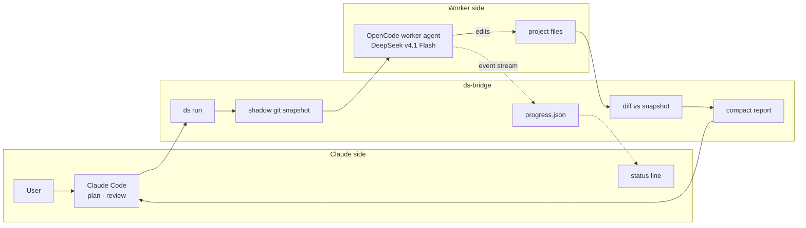
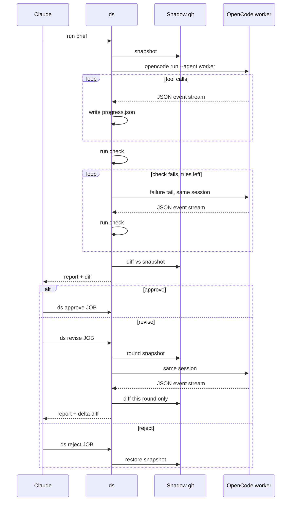
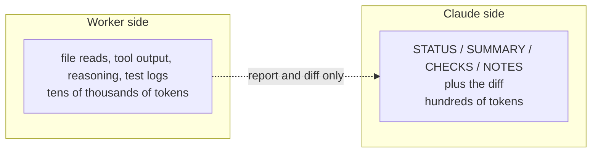

# ds-bridge

Claude plans and reviews, DeepSeek types. A cheap OpenCode worker for Claude Code that returns a summary and a diff, not files.

## Why

Claude usage is expensive, but delegating only saves money if the orchestrator doesn't re-read everything afterwards. ds-bridge keeps Claude's input to a ≤150-word report plus a diff the bridge computes itself — it doesn't trust the worker's account of what it changed — capped at 250 lines.

Measured: reviewing a job costs Claude roughly 600–900 tokens. A revision round shows only that round's delta, so iterating stays cheap too.

This README, the installer and the live-progress feature were written by the worker through ds-bridge itself, then reviewed by Claude.

## How it works





**What Claude reads vs what stays with the worker**



## Live progress

Claude Code's status line can poll ds-bridge once a second (`refreshInterval: 1`) and render the worker's current step:

```
⠴ DeepSeek 1104-152450 r1 · 0:05 · step 2 · 4 tools · 144 tok · 152 tok/s · ▸ read notes.txt
⠙ DeepSeek 1104-152510 r1 · 0:02 · step 1 · 1 tool · 18 tok · ▸ rg "def main"
✓ DeepSeek 1104-152450 done in 0:11
DeepSeek idle · 4 jobs today · ≈38k tok saved
```

Each active job gets its own line, up to four; when nothing is running the line shows today's ledger instead. A run or revise that lasts at least `notify_min_s` seconds also sends a desktop notification with the job id, project, duration and check result.

There is no percentage. An agent can't know its step count in advance, so the line shows elapsed time, the step reached so far, and the last tool call instead of inventing a progress bar.

tok/s is the model's generation speed averaged over finished steps, with tool run time excluded; it appears after the first step completes.

## Commands

| Command | Description |
| --- | --- |
| `ds run -C <dir> "<task>"` | Start a job: snapshot, run the worker (and optional check/fix loop), print report + diff. |
| `ds init [-C <dir>] [--refresh]` | Start a job that writes or refreshes `AGENTS.md` at the project root. |
| `ds revise JOB "<points>"` | Send numbered feedback in the same session; shows only this round's diff. |
| `ds diff JOB [PATH…]` | Re-show the diff, optionally `--full` or for specific paths. |
| `ds approve JOB` | Mark the job accepted; the changes stay in place. |
| `ds reject JOB` | Restore the project to the pre-job snapshot, removing files the worker created. |
| `ds list` | List recent jobs with status and round. |
| `ds stats [--days N \| --all]` | Summarise the ledger: jobs, rounds, worker tokens, Claude's reads and estimated savings. |
| `ds log JOB [--tools-only]` | Print a readable transcript of the job's OpenCode session. |

Flags: `-C DIR` sets the project directory (`run` and `init`), `-m MODEL` overrides the model for one job, `-f FILE` attaches a file to the brief (repeatable), `--paths P…` limits the job's file scope, and `--check CMD` / `--fix-tries N` control the acceptance check (also on `revise`).

### `--check` and the fix loop

`ds run -C <dir> --check "pytest -q" "<task>"` runs CMD with `bash -c` in the project after the worker's first answer. If it exits non-zero (or hits `check_timeout_s`), the bridge sends the last 60 lines of output back into the same session and asks for a fix, then runs the check again, at most `fix_tries` times. The report gets a `--- check` section with PASS/FAIL and the number of auto-fix rounds, and the diff includes every change from those rounds.

### Soft deadline

A worker call that passes `soft_timeout_frac × timeout_s` (default `0.8`, so 24 minutes of a 30-minute run) is stopped and the same session is asked for its final report, including anything unfinished. That wrap-up call has its own limit, `wrapup_s` (default `180`). The `--check` still runs afterwards, and the report starts with `SOFT DEADLINE HIT`. This applies to `ds run`, `ds init` and `ds revise`, including auto-fix rounds.

### `--paths` and parallel jobs

`--paths P…` limits the snapshot, diff and reject scope to those paths relative to `-C`. Independent subtasks can run in parallel: start several `ds run ... --paths <their files>` calls in the background, then review each report as it arrives. Jobs whose paths overlap a running job in the same project are refused. `ds revise` keeps the job's original scope.

With `--paths`, the bridge also records a cheap path/size/mtime listing of the whole project before the run and compares it afterwards. Files outside the job's paths that were created, changed or deleted appear in a `--- WARNING: changes outside --paths` section (up to 20 lines). Paths matching `outside_ignore` are skipped. Nothing is recorded or printed when `--paths` is not used.

### `ds init` and AGENTS.md

`ds init -C <project>` is a normal job (snapshot, worker, report, approve/revise/reject) with a built-in task: explore the project and write `AGENTS.md` at the root, at most 40 lines of facts about layout, build/test/lint/run commands, conventions and things not to touch. It is scoped with `--paths AGENTS.md`. If `AGENTS.md` already exists it refuses unless you pass `--refresh`, which asks the worker to update the existing file and keep correct lines. OpenCode loads `AGENTS.md` automatically, so later briefs can be shorter.

### Guard hook

`install.sh` adds a Claude Code `PreToolUse` hook (`hooks/guard.py`) for `Edit`, `Write`, `MultiEdit` and `NotebookEdit`. Direct edits to project files are blocked with a message to delegate through `ds`; `~/.claude/`, `/tmp/claude-*` scratchpads and globs in `guard_allow` are allowed. Pause it with `touch ~/.config/ds-bridge/guard-off` or `DS_GUARD_OFF=1`. It can't stop edits made through Bash (heredocs, sed), so it is a guardrail, not a sandbox.

### Stats and log

Every report appends one line to `~/.local/share/ds-bridge/ledger.jsonl`. `ds stats` prints jobs (distinct ids), rounds (ledger rows), worker tokens in/cache/out, what Claude read, and an estimated saving:

> saved = worker input + 0.1 × worker cache reads + worker output − Claude's read characters / 4

Plainly: the input-equivalent tokens the worker spent doing the job (cache reads counted at a tenth) minus the tokens Claude used reading the compact report and diff. It is an estimate, not a measurement. `ds log JOB` exports the session; `--tools-only` hides text and shows the tool calls.

## Install

Requirements:

- Claude Code with status-line `refreshInterval` support.
- OpenCode 2.x with a DeepSeek-capable provider — for example an OpenCode Go subscription, model `opencode-go/deepseek-v4.1-flash`.
- `python3`, `git` and `jq` (used by the status line).

```bash
git clone https://github.com/vladgabrielboca/ds-bridge.git
cd ds-bridge
./install.sh
```

The installer merges the `worker` agent into `~/.config/opencode/opencode.json` (backing it up first), links `ds` into `~/.local/bin`, and adds the status line and the `PreToolUse` guard hook to `~/.claude/settings.json`. It never edits `CLAUDE.md` itself, so finish by adding the rules in `claude-rules.md` to `~/.claude/CLAUDE.md` (or a project `CLAUDE.md`). The guard is active immediately; `touch ~/.config/ds-bridge/guard-off` pauses it.

`./install.sh --uninstall` removes the worker agent, the symlink, the status line and the guard hook, touching only what ds-bridge created.

> OpenCode Go DeepSeek models need the workspace region set to **Global** in its Privacy settings.

## Configuration

Optional `~/.config/ds-bridge/config.json` overrides these defaults:

| Key | Default | Meaning |
| --- | --- | --- |
| `model` | `opencode-go/deepseek-v4.1-flash` | Model used by the worker. |
| `agent` | `worker` | OpenCode agent to run. |
| `max_diff_lines` | `250` | Lines of diff shown to Claude before truncation. |
| `max_report_chars` | `1500` | Cap on the worker's report (about 150 words). |
| `timeout_s` | `1800` | Per-run timeout. |
| `soft_timeout_frac` | `0.8` | Fraction of `timeout_s` after which the worker is stopped and asked to wrap up. |
| `wrapup_s` | `180` | Time limit for the wrap-up call that writes the final report. |
| `max_files` | `20000` | Refuse to snapshot directories with more tracked files. |
| `big_file_mb` | `5` | Files larger than this are excluded from snapshots. |
| `fix_tries` | `2` | Auto-fix rounds after a failed `--check` (override per job with `--fix-tries`). |
| `check_timeout_s` | `600` | Timeout for one `--check` command. |
| `notify` | `true` | Send a desktop notification when a run or revise finishes. |
| `notify_min_s` | `15` | Don't notify for jobs shorter than this many seconds. |
| `outside_ignore` | `[".git", "__pycache__", "media*", "*.log", "node_modules", ".venv"]` | Globs ignored by the `--paths` outside-change warning. |
| `guard_allow` | `[]` | Globs of paths the guard hook always allows (for example `~/work/sandbox/*`). |

## Safety

The worker's `bash` permission denies `git commit`, `git push`, `git reset`, `git checkout` and `sudo`. `ds` refuses to run in `$HOME` or `/`. Snapshots live outside your repository in `~/.local/share/ds-bridge/shadow`, so your own `.git` is never touched. Media and big files, `node_modules/`, virtualenvs, build output and caches are excluded. `ds reject` restores the pre-job state.

## Limitations

- No real percentage progress — the status line counts steps, not total work.
- Files over 5 MB aren't snapshotted, so `ds reject` can't restore them.
- The worker's quality is a flash model's; review is mandatory.
- Token savings from `ds stats` are an estimate, not a measurement.
- The guard hook covers Claude's edit tools only; it can't see Bash-based edits.
- Auto-fix rounds restart the status-line timer for each worker call.

## License

MIT. This project is not affiliated with Anthropic, DeepSeek or OpenCode.
