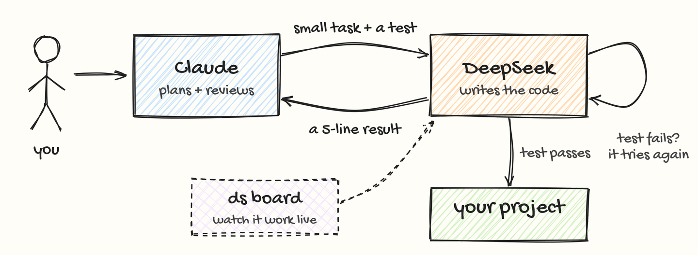
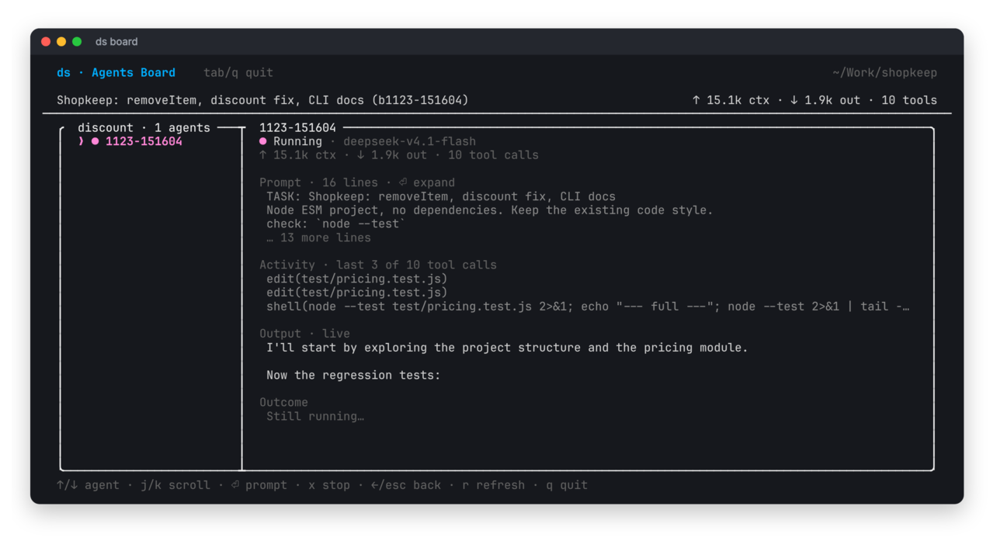
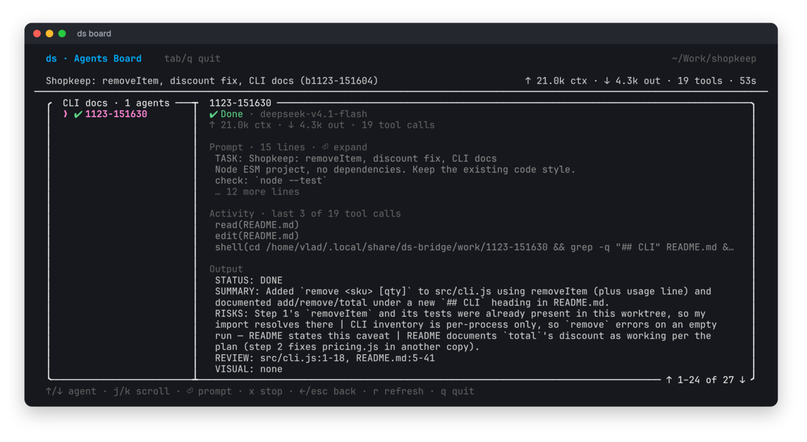
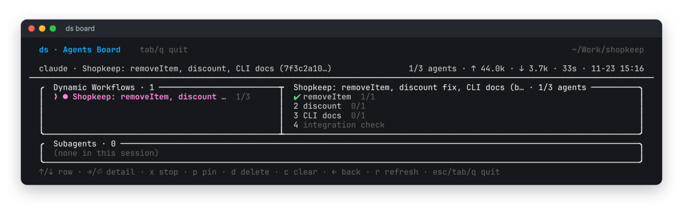

# ds-bridge

Claude plans and reviews. A cheap DeepSeek worker writes the code.

ds-bridge is a command (`ds`) that Claude Code calls to hand a job to an [OpenCode](https://opencode.ai) worker running DeepSeek. The worker edits a private copy of your project and runs your test. When the test passes, the change lands in your project. Claude gets back a few lines instead of reading every file the worker touched, which keeps your Claude usage low.



## What it looks like

You ask Claude for something. Claude writes a short plan and runs one command:

```bash
ds batch -C ~/Work/shopkeep plan.md
```

80 seconds later Claude reads this and nothing else:

```
BATCH b1123-151604 groups=3 ok=3 not_ok=0 integration=pass 80s
OK 1123-151604-1 files=2 +29/-1 check=pass 26s landed  (step 1)
OK 1123-151604 files=2 +27/-1 check=pass 36s landed  (step 2)
OK 1123-151630 files=2 +42/-2 check=pass 54s landed  (step 3)
next: nothing to do: every step landed (undo one with ds reject JOB)
```

While it runs, `ds board` in a second terminal shows what each worker is doing right now: the tools it calls and the text it writes.



When a job ends, its card shows the worker's report.



A Claude chat's page lists its batches and single jobs.



## Install

You need Claude Code, OpenCode 2.x with a DeepSeek model (an OpenCode Go plan works), `python3`, `git` and `jq`. Go 1.27+ is optional and only builds the board.

```bash
git clone https://github.com/vladgabrielboca/ds-bridge.git
cd ds-bridge
./install.sh
```

The installer adds the `worker` agent to OpenCode, links `ds` into `~/.local/bin`, and adds the status line, hooks and the `/ds:*` plugin to Claude Code. It backs up the OpenCode config first. `./install.sh --uninstall` removes only what it added.

Then paste `claude-rules.md` into your `~/.claude/CLAUDE.md`. The installer never edits that file.

OpenCode Go's DeepSeek models need the workspace region set to Global in its privacy settings.

## Use

Delegation is off by default, so Claude works normally. Turn it on per chat.

- `/ds:on` sends this chat's work to the worker. Saying "use ds" works too.
- `/ds:off` turns it off.
- `/ds:status` shows the worker model and what happens on failure.

With it on, Claude runs commands like these for you.

| Command | What it does |
| --- | --- |
| `ds run -C DIR --check "CMD" "task"` | One job. Lands by itself when `CMD` passes. |
| `ds batch -C DIR plan.md` | A plan's steps as parallel jobs, then the plan's own check. |
| `ds research -C DIR "question"` | A short answer about the code, with file refs. Changes nothing. |
| `ds revise JOB "1. ..."` | Send feedback to the same worker session. |
| `ds reject JOB` | Undo a job's changes. |
| `ds board` | The live board. |
| `ds cost` | What this Claude chat cost, from its transcript. |

The status line shows each running job in one line:

```
⠴ DeepSeek 1104-152450 r1 · 0:05 · step 2 · 4 tools · 144 tok · ▶ 162 tok/s · ▸ read notes.txt
```

On the board, arrows move, `j/k` scroll a card, `x` stops a job, `p` pins it, `d` deletes a finished one and `q` quits. The board never approves or rejects work. Claude does that.

Every command, flag and config key is in [docs/reference.md](docs/reference.md). Config goes in `~/.config/ds-bridge/config.json`.

## Limits

- The worker is a fast, cheap model. Claude still reviews what it can't test.
- ds never commits. Landed changes stay uncommitted until you commit them.
- The guard hook stops Claude's edit tools in delegated chats, but not edits made through shell commands.

## License

MIT. Not affiliated with Anthropic, DeepSeek or OpenCode.

The board (`board/`) is a port of the Agents Board from [cc-fleet](https://github.com/ethanhq/cc-fleet) at commit `29262a6`, under Apache 2.0. See `board/LICENSE-cc-fleet` and `board/NOTICE`. The merge logic and parts of the hooks are adapted from cheap-agent (MIT, `bench/LICENSE-cheap-agent`).
