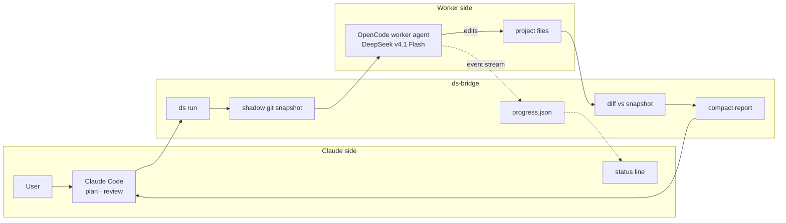
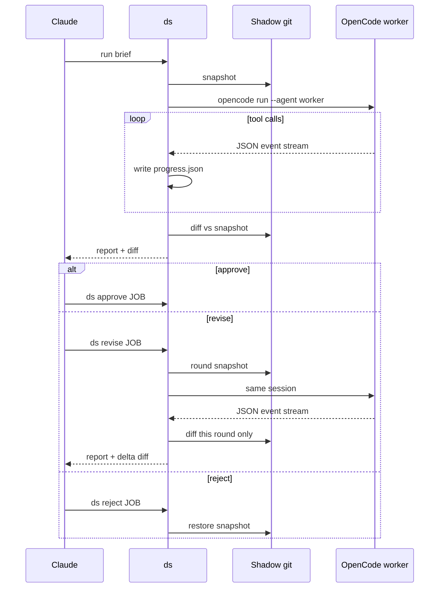
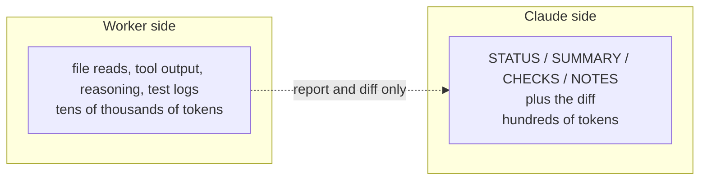

# ds-bridge

Claude plans and reviews, DeepSeek types. A cheap OpenCode worker for Claude Code that returns a summary and a diff, not files.

## Why

Claude usage is expensive, but delegating only saves money if the orchestrator doesn't re-read everything afterwards. ds-bridge keeps Claude's input to a ≤150-word report plus a diff the bridge computes itself — it doesn't trust the worker's account of what it changed — capped at 250 lines.

Measured: reviewing a job costs Claude roughly 600–900 tokens. A revision round shows only that round's delta, so iterating stays cheap too.

This README, the installer and the live-progress feature were written by the worker through ds-bridge itself, then reviewed by Claude.

## How it works





**What Claude reads vs what stays with the worker**



## Live progress

Claude Code's status line can poll ds-bridge once a second (`refreshInterval: 1`) and render the worker's current step:

```
⠴ DeepSeek 1104-152450 r1 · 0:05 · step 2 · 4 tools · 144 tok · ▸ read notes.txt
✓ DeepSeek 1104-152450 done in 0:11
```

There is no percentage. An agent can't know its step count in advance, so the line shows elapsed time, the step reached so far, and the last tool call instead of inventing a progress bar.

## Commands

| Command | Description |
| --- | --- |
| `ds run -C <dir> "<task>"` | Start a job: snapshot, run the worker, print report + diff. |
| `ds revise JOB "<points>"` | Send numbered feedback in the same session; shows only this round's diff. |
| `ds diff JOB [PATH…]` | Re-show the diff, optionally `--full` or for specific paths. |
| `ds approve JOB` | Mark the job accepted; the changes stay in place. |
| `ds reject JOB` | Restore the project to the pre-job snapshot, removing files the worker created. |
| `ds list` | List recent jobs with status and round. |

Flags: `-C DIR` sets the project directory (`run` only), `-m MODEL` overrides the model for one job, and `-f FILE` attaches a file to the brief (repeatable).

## Install

Requirements:

- Claude Code with status-line `refreshInterval` support.
- OpenCode 2.x with a DeepSeek-capable provider — for example an OpenCode Go subscription, model `opencode-go/deepseek-v4.1-flash`.
- `python3`, `git` and `jq` (used by the status line).

```bash
git clone https://github.com/vladgabrielboca/ds-bridge.git
cd ds-bridge
./install.sh
```

The installer merges the `worker` agent into `~/.config/opencode/opencode.json` (backing it up first), links `ds` into `~/.local/bin`, and adds the status line to `~/.claude/settings.json`. It never edits `CLAUDE.md` itself, so finish by adding the rules in `claude-rules.md` to `~/.claude/CLAUDE.md` (or a project `CLAUDE.md`).

`./install.sh --uninstall` removes the worker agent, the symlink and the status line, touching only what ds-bridge created.

> OpenCode Go DeepSeek models need the workspace region set to **Global** in its Privacy settings.

## Configuration

Optional `~/.config/ds-bridge/config.json` overrides these defaults:

| Key | Default | Meaning |
| --- | --- | --- |
| `model` | `opencode-go/deepseek-v4.1-flash` | Model used by the worker. |
| `agent` | `worker` | OpenCode agent to run. |
| `max_diff_lines` | `250` | Lines of diff shown to Claude before truncation. |
| `max_report_chars` | `1500` | Cap on the worker's report (about 150 words). |
| `timeout_s` | `1800` | Per-run timeout. |
| `max_files` | `20000` | Refuse to snapshot directories with more tracked files. |
| `big_file_mb` | `5` | Files larger than this are excluded from snapshots. |

## Safety

The worker's `bash` permission denies `git commit`, `git push`, `git reset`, `git checkout` and `sudo`. `ds` refuses to run in `$HOME` or `/`. Snapshots live outside your repository in `~/.local/share/ds-bridge/shadow`, so your own `.git` is never touched. Media and big files, `node_modules/`, virtualenvs, build output and caches are excluded. `ds reject` restores the pre-job state.

## Limitations

- No real percentage progress — the status line counts steps, not total work.
- Files over 5 MB aren't snapshotted, so `ds reject` can't restore them.
- The worker's quality is a flash model's; review is mandatory.

## License

MIT. This project is not affiliated with Anthropic, DeepSeek or OpenCode.
